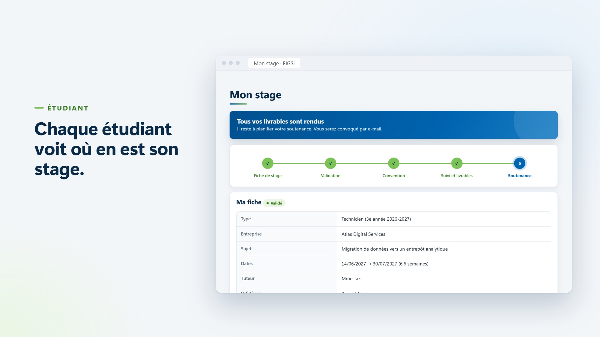

# Plateforme de gestion des stages PFA/PFE — EIGSI Casablanca

Version « réelle » de la plateforme, construite après le MVP de démonstration (`../mvp_SAADALI_WALID/`) en s'appuyant sur la conception des séances 1 et 2 (processus, besoins, base de données). **Auteur : Walid SAADALI**, dans le cadre du projet du cours *Système d'information et transformation digitale*.

## Ce que fait la plateforme
Elle suit chaque stage de la **déclaration jusqu'à la soutenance** et remplace les e-mails, les saisies à la main et les relances entre étudiants, encadrants, Service Stages (Career Center) et jury :

- l'**étudiant** déclare et soumet sa fiche de stage, suit son dossier (frise des étapes), dépose le scan de sa convention et voit ses livrables et sa soutenance ;
- l'**encadrant** (4e et 5e année) ou le **coordinateur** (1re à 3e année) valide ou refuse la fiche, avec un motif ;
- le **Career Center** affecte les encadrants, génère les conventions (PDF), vérifie les signatures, suit les livrables, importe les listes (WebAurion, Moodle) et organise les soutenances ;
- le **jury** indique ses disponibilités et saisit le PV et la note ;
- un **assistant IA** (Google Gemini) qui répond aux questions sur l'utilisation du site selon le rôle, et relit le sujet de stage avant la soumission. **L'IA propose, l'humain décide** ; sans clé ou sans Internet, un mode de secours prend le relais ([`docs/15-IA.md`](docs/15-IA.md)) ;
- des **rappels et relances automatiques** par e-mail ; des **droits par rôle** ; la protection des données (loi 09-08).

23 user stories (17 *Must*, 3 *Should*, 3 *Could*) → [`docs/03-Besoins-et-backlog.md`](docs/03-Besoins-et-backlog.md).

## Essayer la démo (Windows, 5 minutes)
1. Installer **Python 3.10 ou plus** (<https://www.python.org/downloads/>, cocher *Add python.exe to PATH*).
2. Télécharger ce dépôt (*Code → Download ZIP*) ou le cloner, puis ouvrir le dossier `plateforme_finale/app/`.
3. **Double-clic sur `LANCER_LA_DEMO.bat`**. Le premier lancement installe tout (2 à 5 minutes, Internet nécessaire) ; ensuite c'est instantané.
4. Le navigateur s'ouvre sur <http://localhost:8000/>. Comptes fictifs `…@example.test`, **mot de passe commun : `Demo-EIGSI-2026`**.

Les comptes, les situations de chaque étudiant et un déroulé de présentation sont dans [`docs/13-Demo-presentation.md`](docs/13-Demo-presentation.md). La démo utilise sa propre base (`demo.sqlite3`) : aucune vraie donnée.

[](../Demo/plateforme_finale_presentation.mp4)
*▶ Cliquer sur l'image pour voir la vidéo de présentation (22 secondes).*

## Assistant IA : brancher sa propre clé (facultatif)
**Sans clé, tout fonctionne** : l'assistant et la relecture du sujet répondent en « mode démonstration » à partir des textes d'aide du site. La **vraie IA** (Google Gemini) demande une clé API, qui est **personnelle** : elle n'est donc **jamais** dans ce dépôt (le fichier est exclu par `.gitignore`). Sur un nouvel ordinateur :

1. **Créer une clé** avec un compte Google : <https://aistudio.google.com/apikey> → *Create API key* (gratuit). Toute clé Gemini convient : celle de Walid, la vôtre, ou celle d'un autre compte.
2. **Créer un fichier texte nommé exactement `cle_gemini.txt`** dans le dossier `plateforme_finale/app/`, à côté de `manage.py` et de `LANCER_LA_DEMO.bat`. Il ne contient qu'une **ligne : la clé**.
3. **Relancer** `LANCER_LA_DEMO.bat`. Internet est alors nécessaire pour l'IA.

> ⚠️ **Piège fréquent sous Windows** : les extensions sont cachées, donc un fichier créé avec le Bloc-notes peut s'appeler en réalité `cle_gemini.txt.txt` et ne sera pas lu. Dans l'Explorateur : *Affichage* → cocher *Extensions de noms de fichiers*, puis vérifier le nom.

Autre possibilité : définir la variable d'environnement `GEMINI_API_KEY` à la place du fichier. Détails, protection des données et mode de secours : [`docs/15-IA.md`](docs/15-IA.md).

## Technique
- **Django 5.2** (pages rendues par le serveur), SQLite en développement, PostgreSQL en ligne, PDF avec ReportLab, aucune bibliothèque externe côté navigateur.
- **296 tests automatiques** : `cd app` puis `.venv\Scripts\python manage.py test`.
- Documentation du code et des commandes : [`app/README.md`](app/README.md). Mise en ligne : [`docs/12-Mise-en-ligne.md`](docs/12-Mise-en-ligne.md).

## Organisation
```
plateforme_finale/
├── app/    le code (Django) : applications comptes, stages, soutenances, espaces
└── docs/   la conception et les décisions (notes Obsidian)
```
Les comptes et entreprises de démonstration sont **fictifs**. Aucun mot de passe réel, aucune base de données ni fichier déposé n'est dans ce dépôt.
